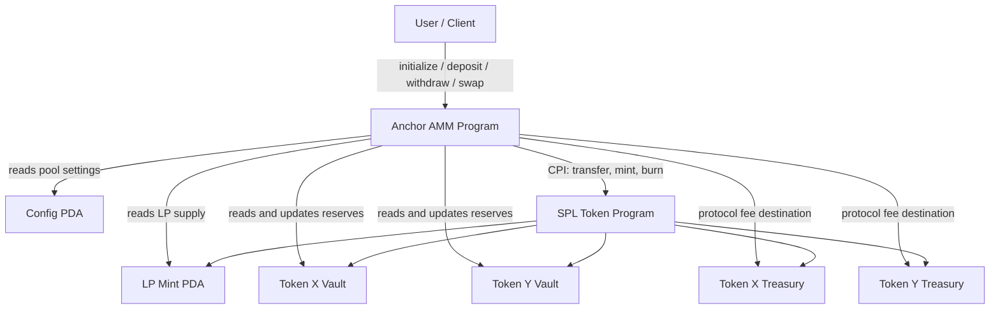
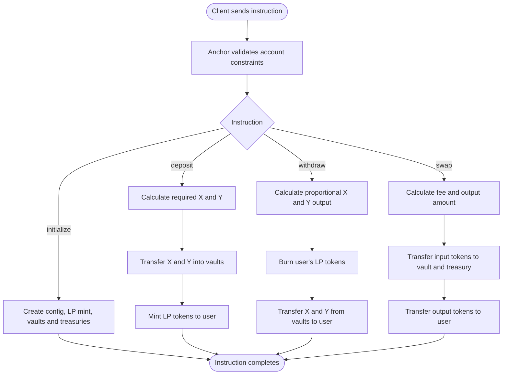
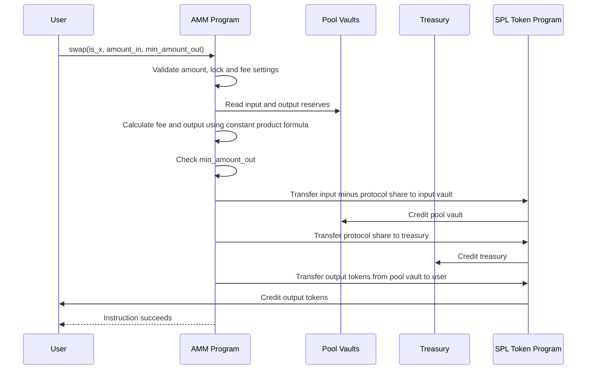

# Solana Constant Product AMM

A simple automated market maker (AMM) program built with **Solana**, **Anchor**, and the **SPL Token Program**.

The program manages a token pair, holds both assets in pool vaults, issues liquidity-provider (LP) tokens, allows users to add or remove liquidity, and swaps between the two assets using the constant product pricing model.

> **Project status:** The Anchor program compiled successfully in the reported test run, and the four integration tests (`initialize`, `deposit`, `withdraw`, and `swap`) passed. This is a development project, not an audited or production-ready protocol. Passing tests does not establish economic correctness or security.

---

## Contents

- [Overview](#overview)
- [How a constant product AMM works](#how-a-constant-product-amm-works)
- [Architecture](#architecture)
- [Program accounts](#program-accounts)
- [Instructions](#instructions)
- [Swap fee model](#swap-fee-model)
- [Account and authority model](#account-and-authority-model)
- [Project layout](#project-layout)
- [Build and test](#build-and-test)
- [Test status](#test-status)
- [Important implementation notes](#important-implementation-notes)
- [Limitations](#limitations)

---

## Overview

A constant product AMM lets users trade two tokens against shared liquidity rather than matching individual buy and sell orders. The pool maintains reserves of token X and token Y. A trade changes the reserve ratio, which changes the price available for the next trade.

This program has four main instructions:

| Instruction | Purpose |
|---|---|
| `initialize` | Creates the pool configuration, LP mint, token vaults, and treasury token accounts. |
| `deposit` | Accepts token X and token Y from a liquidity provider and mints LP tokens. |
| `withdraw` | Burns a user's LP tokens and transfers the corresponding pool assets back. |
| `swap` | Exchanges one pool token for the other and routes the protocol share of the fee to a treasury. |

The program uses a configuration PDA as the authority for pool token accounts and the LP mint. Token movements and LP token minting/burning are carried out through CPI calls to the SPL Token Program.

## How a constant product AMM works

The pool follows the constant product relationship:

\[
X \times Y = k
\]

Where:

- `X` is the amount of token X held by the pool.
- `Y` is the amount of token Y held by the pool.
- `k` is the product of the reserves.

The product is not expected to remain numerically identical after every swap when fees are retained by the pool. In a fee-charging AMM, the fee increases the pool's reserves relative to the amount used for pricing the swap.

### Price intuition

If a user buys token Y with token X, the pool receives X and sends out Y. The pool consequently holds relatively more X and less Y. The next user will generally receive less Y for the same amount of X, before considering fees and rounding.

The instantaneous reserve ratio is a useful way to understand the pool price:

\[
P_{X\rightarrow Y} \approx \frac{Y}{X}
\]

This is a reserve-ratio intuition, not a guaranteed execution price. The actual execution price depends on trade size, fees, integer rounding, and the pool's reserves.

## Architecture

### High-level architecture

The client submits an Anchor instruction with the required accounts and instruction arguments. The AMM program validates the accounts and pool state, calculates the operation, and invokes the SPL Token Program to transfer, mint, or burn tokens.



### Instruction flow



### Swap flow

The `is_x` argument selects which token the user supplies:

- `is_x = true`: token X is the input; token Y is the output.
- `is_x = false`: token Y is the input; token X is the output.



All token transfers in a single Solana instruction are atomic. If a CPI or a later check fails, the transaction's state changes are rolled back.

## Program accounts

The following accounts are involved in the pool. Exact account constraints and PDA seeds are defined in the instruction account structs.

| Account | Role |
|---|---|
| `user` / `initializer` | Transaction signer and, where required, payer for account creation. |
| `config` | Pool state PDA. Stores the token mints, fee settings, lock state, optional authority, and PDA bumps. It is also the authority for pool-controlled token operations. |
| `mint_x`, `mint_y` | SPL token mints that define the pool's token pair. |
| `mint_lp` | LP token mint PDA. The config PDA is its mint authority. |
| `vault_x`, `vault_y` | Token accounts that hold the pool's token X and token Y reserves. |
| `user_x`, `user_y` | The user's token accounts used for deposits, swaps, and withdrawals. |
| `user_lp` | The user's LP token account. It is created when needed during deposit. |
| `treasury_x`, `treasury_y` | Token accounts that receive the protocol portion of swap fees, denominated in the input token. |
| `token_program` | SPL Token Program used for token transfers, LP minting, and LP burning. |
| `associated_token_program` | Creates associated token accounts where the instruction uses them. |
| `system_program` | Creates and funds program accounts. |

### Config state

The `Config` account stores the settings for one pool:

| Field | Description |
|---|---|
| `seed: u64` | Seed used to derive the pool configuration PDA. |
| `authority: Option<Pubkey>` | Optional authority address for administrative operations. |
| `mint_x: Pubkey` | Token X mint address. |
| `mint_y: Pubkey` | Token Y mint address. |
| `fee: u16` | Swap fee in basis points. |
| `protocol_fee: u16` | Protocol's share, expressed in basis points of the total fee rate. |
| `locked: bool` | Indicates whether pool operations that check this flag are locked. |
| `config_bump: u8` | PDA bump for the config account. |
| `lp_bump: u8` | PDA bump for the LP mint. |

A basis point is one hundredth of one percent. Therefore, `100` basis points is `1%`, and `10_000` basis points is `100%`.

## Instructions

### 1. `initialize`

Creates the pool's foundational accounts and writes the pool configuration.

**Arguments**

| Argument | Description |
|---|---|
| `seed` | Unique seed used when deriving the config PDA. |
| `fee` | Total swap fee in basis points. |
| `protocol_fee` | Protocol share rate in basis points, relative to the total fee rate. |
| `authority` | Optional authority address stored in the config. |

**Accounts created or initialized**

- Config PDA.
- LP mint PDA, with the config PDA as mint authority.
- Token X and token Y pool vaults.
- Token X and token Y treasury token accounts.

The LP mint in the shared implementation is configured with 6 decimals. Pool token reserve amounts are maintained in the token's smallest units.

### 2. `deposit`

Adds both assets to the pool and mints LP tokens to the liquidity provider.

**Arguments**

| Argument | Description |
|---|---|
| `amount` | Requested LP token amount. |
| `max_x` | Maximum token X amount the user permits the instruction to deposit. |
| `max_y` | Maximum token Y amount the user permits the instruction to deposit. |

For an existing pool, a proportional deposit should preserve the pool's reserve ratio. The LP provider receives LP tokens representing their share of the pool. The `max_x` and `max_y` values act as deposit limits; the instruction fails with a slippage error if the calculated amounts exceed them.

The first deposit requires special handling because there is no existing LP supply or reserve ratio. The exact initial LP issuance policy must be implemented and tested explicitly; it should not simply mint an arbitrary LP amount unrelated to the assets deposited.

### 3. `withdraw`

Burns LP tokens and returns the corresponding share of the pool's token X and token Y reserves.

**Arguments**

| Argument | Description |
|---|---|
| `amount` | Number of LP tokens to burn. |
| `min_x` | Minimum token X amount the user is willing to receive. |
| `min_y` | Minimum token Y amount the user is willing to receive. |

For a proportional withdrawal, the underlying amounts are calculated using the user's share of the LP supply:

\[
X_{out} = \left\lfloor\frac{LP_{burned} \times X_{reserve}}{LP_{supply}}\right\rfloor
\]

\[
Y_{out} = \left\lfloor\frac{LP_{burned} \times Y_{reserve}}{LP_{supply}}\right\rfloor
\]

The instruction checks the minimum amounts, burns the LP tokens, and transfers the assets from the pool vaults to the user. Integer division rounds down, so a small remainder can remain in the pool.

### 4. `swap`

Swaps one token in the pool for the other.

**Arguments**

| Argument | Description |
|---|---|
| `is_x` | `true` means X is input and Y is output; `false` means Y is input and X is output. |
| `amount_in` | Amount of input tokens supplied by the user. |
| `min_amount_out` | Minimum output amount accepted by the user. |

The instruction:

1. Rejects a zero input amount and a locked pool.
2. Validates the fee configuration.
3. Reads the input and output reserves.
4. Calculates the trading fee and effective input.
5. Calculates output using the constant product formula.
6. Checks the user's minimum output.
7. Splits the trading fee between the pool and the protocol treasury.
8. Transfers the input tokens and sends output tokens to the user.

## Swap fee model

The fee values are represented in basis points (`bps`), with `10_000` representing 100%.

Let:

- `A` = input amount.
- `F` = total swap fee in basis points.
- `B` = `10_000` basis points.
- `PF` = protocol fee parameter in basis points.
- `R_in` = input reserve.
- `R_out` = output reserve.

The trading fee is calculated as:

\[
fee = \left\lfloor\frac{A \times F}{B}\right\rfloor
\]

The amount used in the pricing calculation is:

\[
A_{effective} = A - fee
\]

The output amount is:

\[
amount_{out} = \left\lfloor\frac{R_{out} \times A_{effective}}{R_{in} + A_{effective}}\right\rfloor
\]

The protocol's share of the calculated trading fee is:

\[
protocol\_fee = \left\lfloor\frac{fee \times PF}{F}\right\rfloor
\]

When `F` is zero, the protocol fee is zero. The amount credited to the pool vault is:

\[
pool\_deposit = A - protocol\_fee
\]

This means the non-protocol portion of the trading fee remains in the pool. The output calculation uses the effective input after the full trading fee, while the pool receives the input less only the protocol share.

The implementation uses checked integer arithmetic and `u128` intermediate values for these calculations. Results are ultimately represented in token base units (`u64`). Integer division rounds down.

## Account and authority model

The config PDA is derived from the `config` seed and the pool's little-endian `seed` value:

```text
[ b"config", seed.to_le_bytes() ]
```

The LP mint PDA is derived from:

```text
[ b"lp", config_pubkey ]
```

The config PDA signs CPI calls that transfer tokens out of the pool vaults and mint LP tokens. A user signs transfers from their own token accounts and burns their own LP tokens.

The pool vaults and treasury token accounts are controlled by the config PDA. Their address derivation and initialization constraints must match in every instruction that references them.

## Project layout

The program is organized around the Anchor program entry point, instruction handlers, persistent state, constants, and custom errors. The following is a representative layout based on the modules shared for this project; filenames can differ depending on how the modules are arranged in the repository.

```text
amm-solana/
├── Anchor.toml
├── Cargo.toml
├── programs/
│   └── amm_solana/
│       ├── Cargo.toml
│       └── src/
│           ├── lib.rs
│           ├── constants.rs
│           ├── error.rs
│           ├── state/
│           │   ├── mod.rs
│           │   └── config.rs
│           └── instructions/
│               ├── mod.rs
│               ├── initialize.rs
│               ├── deposit.rs
│               ├── withdraw.rs
│               └── swap.rs
└── tests/
    └── test.rs
```

## Build and test

### Prerequisites

Install the Solana toolchain, Anchor CLI, and Rust toolchain required by the versions configured in the repository. The exact versions should be kept consistent across local development and CI.

Check the installed tools:

```bash
solana --version
anchor --version
rustc --version
cargo --version
```

### Build the program

From the repository root:

```bash
anchor build
```

### Run the tests

```bash
anchor test
```

The Anchor test command builds the program and runs the test script configured in `Anchor.toml`.

## Test status

The reported `anchor test` run completed successfully:

| Test | Result |
|---|---|
| `test_initialize` | Passed |
| `test_deposit` | Passed |
| `test_withdraw` | Passed |
| `test_swap` | Passed |

The run also reported eight Rust warnings for unused treasury variables in `tests/test.rs`. These warnings do not fail the tests. Remove unused bindings or prefix intentionally unused variable names with `_` to clean them up.

The current output showed zero unit tests in `src/lib.rs` and four passing integration tests in `tests/test.rs`. Add further tests for edge cases rather than treating this result as exhaustive validation.

## Important implementation notes

Before considering a deployment that handles valuable assets, verify the following against the current source code and tests:

1. **Treasury account derivation:** In the code shared earlier, `Initialize` created treasury accounts as associated token accounts, while `Swap` constrained them using `treasury_x` / `treasury_y` PDA seeds. Those derivations identify different addresses. Make the initialization and swap constraints use the same account derivation.
2. **Initial liquidity issuance:** Ensure the first liquidity provider cannot choose an arbitrary LP token issuance unrelated to the deposited reserves. Define and test the initial LP calculation and any minimum-liquidity policy.
3. **Liquidity math dependency:** The earlier `Deposit` and `Withdraw` snippets still imported `constant_product_curve::ConstantProduct`, even after the swap calculation was rewritten locally. If the goal is to remove that crate completely, replace those calculations too and remove the dependency only after all imports and usages are gone.
4. **Fee configuration:** Validate fees when initializing or updating the pool, not only when swapping. The total fee must be below `10_000` bps, and the protocol share must not exceed the total fee rate.
5. **Token decimals:** Swap math uses raw token base units. Keep all amounts in their mint's smallest units. If a UI displays human-readable values, convert using each mint's decimals off-chain; do not mix display units with on-chain amounts.
6. **Checked arithmetic:** Avoid `.unwrap()` for calculations in on-chain instruction handlers. Convert arithmetic failures into program errors so a malformed or extreme input does not cause an uncontrolled panic.
7. **Account constraints:** Validate that every mint, token account, vault, treasury, and LP account belongs to the intended pool and authority. Keep constraints consistent across all instructions.
8. **Test coverage:** Test both swap directions, zero-fee swaps, fee rounding, maximum permitted fee settings, insufficient user balances, zero or empty reserves, slippage failures, proportional deposits, partial withdrawals, and invalid account substitutions.

## Limitations

- The program uses the classic SPL Token Program interfaces shown in the source (`anchor_spl::token`). Token-2022-specific extensions are not covered by the shared implementation.
- The LP mint is configured with 6 decimals in the shared initialization code.
- The pool is a constant product AMM; it does not use an order book or an external price oracle for swap pricing.
- A reserve-ratio price can move significantly for large trades, especially in pools with low liquidity.
- The shared code does not demonstrate a complete administrative interface for changing authority or lock state.
- The project has not been independently audited. Do not use it to custody production funds without further testing, review, and an audit appropriate to the intended deployment.

---

## License

Add the license for this repository here. Do not imply that the project is open source under a particular license until a license has been selected and included in the repository.
